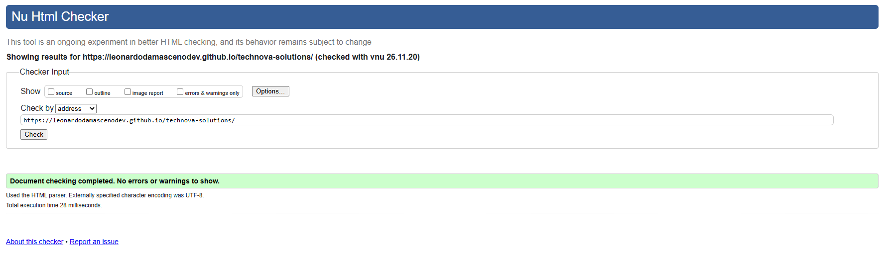
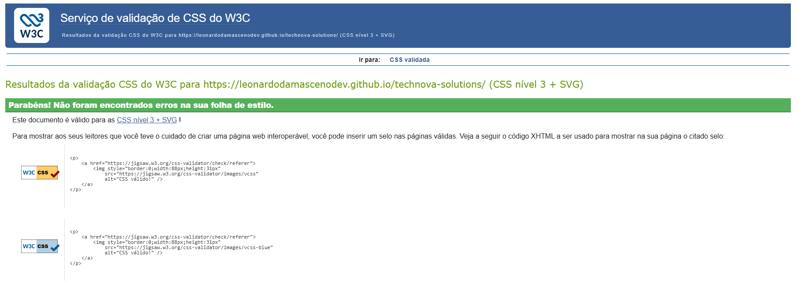

# 🚀 Portal Corporativo TechNova Solutions

Projeto desenvolvido para a **Avaliação Somativa** da Unidade Curricular de **Linguagem de Marcação (HTML5 & CSS3)**.

---

## 🔗 Link Oficial da Entrega
- 🌐 **Site Publicado (GitHub Pages):** [https://leonardodamascenodev.github.io/technova-solutions/](https://leonardodamascenodev.github.io/technova-solutions/)

---

## 📐 Wireframe do Projeto

---

## ✅ Auditoria e Validação Oficial W3C

Clique nos links abaixo para executar a validação em tempo real diretamente no servidor do consórcio W3C, ou confira os comprovantes capturados abaixo:

- 🔍 **[Validar HTML5 no W3C (Ao Vivo)](https://validator.w3.org/nu/?doc=https%3A%2F%2Fleonardodamascenodev.github.io%2Ftechnova-solutions%2F)**
- 🎨 **[Validar CSS3 no W3C Jigsaw (Ao Vivo)](https://jigsaw.w3.org/css-validator/validator?uri=https%3A%2F%2Fleonardodamascenodev.github.io%2Ftechnova-solutions%2F&profile=css3svg)**

### Validação HTML5

### Validação CSS3

---

## 🛠️ Tecnologias e Padrões Aplicados
- **HTML5 Semântico:** `<header>`, `<nav>`, `<main>`, `<section>`, `<article>`, `<aside>`, `<figure>`, `<footer>`.
- **Tabelas Avançadas:** `<thead>`, `<tbody>`, `<tfoot>`, `scope`, `colspan`, `rowspan` e efeito zebrado.
- **Formulários Validados:** `<fieldset>`, `<legend>`, `<label for>`, validações nativas `required`.
- **Otimização Gráfica:** Imagens em formato `.webp` e ícones vetoriais em **SVG Inline** estilizados via CSS.
- **CSS3 Moderno:** Variáveis CSS (`:root`), Box Model, Flexbox/Grid, Menu `position: sticky`, Transições e Animações.
